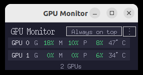
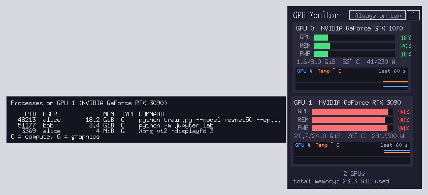

#  GPU Monitor / GPU モニタ

[](https://github.com/Nihonyamori/gpu-monitor/actions/workflows/test.yml)

A tiny Tkinter GUI that shows NVIDIA GPU usage, memory usage, power usage, temperature and memory values in real time. No external Python packages required.

NVIDIA GPU の使用率・メモリ使用率・消費電力率・温度・メモリ絶対値をリアルタイムで小さく表示する Tkinter GUI です。外部 Python パッケージは不要です。


| Compact view / コンパクト表示 | Process list on hover / マウスを乗せるとプロセス一覧（example data / 例示データ） |
|---|---|
|  |  |

---

## English

### What it does

* Monitors all NVIDIA GPUs, reading NVML (`libnvidia-ml.so.1`) directly; falls back to `nvidia-smi`
* Refreshes every 0.5 s (selectable: 0.5 / 1 / 2 / 5 s)
* Per GPU card shows:
  * **GPU** bar – GPU utilization %
  * **MEM** bar – memory utilization %
  * **PWR** bar – power draw / limit %
  * Detail line: `used/total GiB  temp°C  power/limit W`
  * History graph of GPU utilization and temperature for the last 60 s
* Color coding: <70% green, 70-89% yellow, ≥90% red; temperature yellow from 80°C, red from 90°C
* Hover over a card to see the processes using that GPU (PID, user, memory, command)
* Cards are rebuilt automatically when GPUs are added or removed
* "Always on top" toggle button
* Menu (the "⋮" button or right-click): always on top, compact view (one line per GPU), history graph, text size, update interval, window opacity, move to the top-right, quit
* Single instance: launching it again brings the running window to the front
* Remembers the window position; the first launch places it at the top-right
* Settings are persisted to `~/.config/gpu_monitor.json`
* Window fits content exactly with +0px margin, width stabilized

### Requirements

* Python 3 with Tkinter
* NVIDIA driver (`libnvidia-ml.so.1` or the `nvidia-smi` command)
* Linux desktop with DISPLAY

No pip packages needed. Uses only the standard library (`tkinter`, `ctypes`, `subprocess`, ...).

### Install with pipx

```bash
sudo apt install python3-tk pipx      # Tkinter is an OS package on Ubuntu
pipx install git+https://github.com/Nihonyamori/gpu-monitor
gpu-monitor                           # same options as ./gpu_monitor.py
```

Update with `pipx upgrade gpu-monitor`. For the application menu entry and icon, use `install.sh` from a clone (below).

### Quick start (from a clone)

```bash
cd ~/programs/gpu_monitor
./gpu_monitor.py                     # normal start, restores last settings and position
./gpu_monitor.py -A                  # start with always-on-top forced
./gpu_monitor.py --no-always-on-top  # start without always-on-top
./gpu_monitor.py -R                  # start at the top-right, ignoring the saved position
./gpu_monitor.py --nvidia-smi        # use nvidia-smi instead of NVML
./gpu_monitor.py --new-instance      # open another window even if one is running
./gpu_monitor.py --version           # show the version
./gpu_monitor.py --help
```

The first launch places the window at the top-right of the screen. After that it opens where you last closed it.

### Application menu / autostart

```bash
./install.sh               # add "GPU Monitor" (with its icon) to the application menu
./install.sh --autostart   # also start it at login
./install.sh --uninstall   # remove the menu entry, autostart and icon
```

Run it from a terminal where `python3` has Tkinter; the absolute path of that Python is written into the menu entry. Run it again if you move the folder or change Python.

### Always on top

Click the "Always on top" button in the header.
* Green button = ON
* Dim button = OFF

The state is automatically saved to `~/.config/gpu_monitor.json` and restored on next launch.

### Files

* `gpu_monitor.py` – main program
* `install.sh` – adds the program to the application menu / autostart
* `icon.svg` / `icon.png` – application icon (menu / window)
* `tests/` – unit tests (`python3 -m unittest discover -s tests`); run on GitHub Actions without a GPU
* `pyproject.toml` – package definition for pipx / pip
* `scripts/release_notes.py` – CHANGELOG section for a release (used by GitHub Actions)
* `docs/` – README images
* `CHANGELOG.md` – changes per version
* `README.md` – this file
* `USER.md` – user guide (English)
* `USER_J.md` – user guide (Japanese)
* `DEVELOPER.md` – developer documentation (Japanese)
* `gpu_monitor.png` – screenshot
* `LICENSE` – MIT License

Config file: `~/.config/gpu_monitor.json`

### License

MIT. See [LICENSE](LICENSE).

---

## 日本語

### できること

* 全 NVIDIA GPU を監視。NVML（`libnvidia-ml.so.1`）を直接読み、使えなければ `nvidia-smi` を使う
* 0.5 秒間隔で更新（0.5 / 1 / 2 / 5 秒から選べる）
* GPU ごとにカード表示：
  * **GPU** バー – GPU 使用率 %
  * **MEM** バー – メモリ使用率 %
  * **PWR** バー – 消費電力 / 上限 %
  * 詳細行：`使用/総量 GiB  温度°C  消費電力/上限 W`
  * 直近 60 秒の GPU 使用率と温度のグラフ
* 色分け：70% 未満 緑、70〜89% 黄、90% 以上 赤。温度は 80°C 以上で黄、90°C 以上で赤
* カードにマウスを乗せると、その GPU を使っているプロセス（PID・ユーザ・メモリ・コマンド）を表示
* GPU が増減したらカードを自動で作り直す
* 「Always on top」トグルボタン
* メニュー（「⋮」ボタンか右クリック）：常時手前・コンパクト表示（1 GPU 1 行）・グラフ表示・文字サイズ・更新間隔・不透明度・右上へ移動・終了
* 二重起動しない（もう一度起動すると、起動中のウィンドウが手前に出る）
* ウィンドウ位置を記憶（初回は画面右上に配置）
* 設定は `~/.config/gpu_monitor.json` に永続保存
* ウィンドウは内容にピッタリフィット（余白 0px）、幅は安定化

### 要件

* Python 3 + Tkinter
* NVIDIA ドライバ（`libnvidia-ml.so.1` か `nvidia-smi` コマンド）
* DISPLAY 付き Linux デスクトップ

外部パッケージ不要。標準ライブラリのみ使用。

### pipx でインストール

```bash
sudo apt install python3-tk pipx      # Ubuntu では Tkinter は OS のパッケージ
pipx install git+https://github.com/Nihonyamori/gpu-monitor
gpu-monitor                           # オプションは ./gpu_monitor.py と同じ
```

更新は `pipx upgrade gpu-monitor`。アプリメニューへの登録とアイコンは、リポジトリを clone して `install.sh` を使います（下記）。

### 起動方法（clone した場合）

```bash
cd ~/programs/gpu_monitor
./gpu_monitor.py                     # 通常起動。前回の設定と位置を引き継ぐ
./gpu_monitor.py -A                  # 常時手前で起動
./gpu_monitor.py --no-always-on-top  # 常時手前なしで起動
./gpu_monitor.py -R                  # 保存位置を無視して右上に表示
./gpu_monitor.py --nvidia-smi        # NVML の代わりに nvidia-smi を使う
./gpu_monitor.py --new-instance      # 起動中でも別のウィンドウを開く
./gpu_monitor.py --version           # バージョンを表示
./gpu_monitor.py --help              # ヘルプ
```

初回はウィンドウが画面右上に表示されます。2 回目からは前回閉じた位置に開きます。

### アプリメニュー・自動起動

```bash
./install.sh               # アプリメニューに「GPU Monitor」をアイコン付きで登録
./install.sh --autostart   # ログイン時にも自動起動
./install.sh --uninstall   # メニュー項目・自動起動・アイコンを削除
```

`python3` で Tkinter が使えるターミナルから実行してください。その Python の絶対パスがメニュー項目に書き込まれます。フォルダを移動したり Python を変えたりしたら、もう一度実行してください。

### Always on top

ヘッダーの「Always on top」ボタンを押すと ON/OFF が切り替わります。
* 緑 = ON
* 暗い色 = OFF

状態は自動で `~/.config/gpu_monitor.json` に保存され、次回起動時に復元されます。

### ファイル構成

* `gpu_monitor.py` – 本体
* `install.sh` – アプリメニュー・自動起動への登録
* `icon.svg` / `icon.png` – アプリのアイコン（メニュー用 / ウィンドウ用）
* `tests/` – テスト（`python3 -m unittest discover -s tests`）。GitHub Actions で GPU なしに実行
* `pyproject.toml` – pipx / pip 用のパッケージ定義
* `scripts/release_notes.py` – リリース用に CHANGELOG の該当部分を取り出す（GitHub Actions が使う）
* `docs/` – README の画像
* `CHANGELOG.md` – バージョンごとの変更履歴
* `README.md` – このファイル
* `USER.md` – ユーザ向けガイド（英語）
* `USER_J.md` – ユーザ向けガイド（日本語）
* `DEVELOPER.md` – 開発者向けドキュメント（日本語）
* `gpu_monitor.png` – スクリーンショット
* `LICENSE` – MIT ライセンス

設定ファイル：`~/.config/gpu_monitor.json`

### ライセンス

MIT。[LICENSE](LICENSE) を参照。
