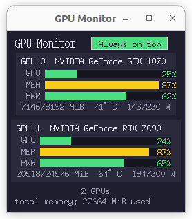

# GPU Monitor / GPU モニタ

A tiny Tkinter GUI that shows NVIDIA GPU usage, memory usage, power usage, temperature and memory values in real time. No external Python packages required.

NVIDIA GPU の使用率・メモリ使用率・消費電力率・温度・メモリ絶対値をリアルタイムで小さく表示する Tkinter GUI です。外部 Python パッケージは不要です。



---

## English

### What it does

* Monitors all NVIDIA GPUs detected by `nvidia-smi`
* Refreshes every 0.5 s
* Per GPU card shows:
  * **GPU** bar – GPU utilization %
  * **MEM** bar – memory utilization %
  * **PWR** bar – power draw / limit %
  * Detail line: `used/total MiB  temp°C  power/limit W`
* Color coding: <70% green, 70-89% yellow, ≥90% red
* "Always on top" toggle button. State is persisted to `~/.config/gpu_monitor.json`
* Window fits content exactly with +0px margin, right-top placement, width stabilized

### Requirements

* Python 3 with Tkinter
* NVIDIA driver with `nvidia-smi` available
* Linux desktop with DISPLAY

No pip packages needed. Uses only stdlib: `tkinter`, `subprocess`, `argparse`, `json`, `pathlib`.

### Quick start

```bash
cd ~/programs/gpu_monitor
./gpu_monitor.py          # normal start, restores last always-on-top setting
./gpu_monitor.py -A       # start with always-on-top forced
./gpu_monitor.py --help
```

Window appears on the top-right of the screen.

### Always on top

Click the "Always on top" button in the header.
* Green button = ON
* Dim button = OFF

The state is automatically saved to `~/.config/gpu_monitor.json` and restored on next launch.

### Files

* `gpu_monitor.py` – main program
* `DEVELOPER.md` – developer documentation
* `USER.md` – Japanese user guide
* `README.md` – this file

Config file: `~/.config/gpu_monitor.json`

### License

MIT. See LICENSE if added.

---

## 日本語

### できること

* `nvidia-smi` で検出された全 NVIDIA GPU を監視
* 0.5 秒間隔で更新
* GPU ごとにカード表示：
  * **GPU** バー – GPU 使用率 %
  * **MEM** バー – メモリ使用率 %
  * **PWR** バー – 消費電力 / 上限 %
  * 詳細行：`使用/総量 MiB  温度°C  消費電力/上限 W`
* 色分け：70% 未満 緑、70〜89% 黄、90% 以上 赤
* 「Always on top」トグルボタン。状態は `~/.config/gpu_monitor.json` に永続保存
* ウィンドウは内容にピッタリフィット（余白 0px）、右上に配置、幅は安定化

### 要件

* Python 3 + Tkinter
* NVIDIA ドライバ、`nvidia-smi` が使える環境
* DISPLAY 付き Linux デスクトップ

外部パッケージ不要。標準ライブラリのみ使用。

### 起動方法

```bash
cd ~/programs/gpu_monitor
./gpu_monitor.py          # 通常起動。前回の Always on top 状態を引き継ぐ
./gpu_monitor.py -A       # 常時手前で起動
./gpu_monitor.py --help   # ヘルプ
```

ウィンドウが画面右上に表示されます。

### Always on top

ヘッダーの「Always on top」ボタンを押すと ON/OFF が切り替わります。
* 緑 = ON
* 暗い色 = OFF

状態は自動で `~/.config/gpu_monitor.json` に保存され、次回起動時に復元されます。

### ファイル構成

* `gpu_monitor.py` – 本体
* `DEVELOPER.md` – 開発者向けドキュメント
* `USER.md` – ユーザ向けガイド
* `README.md` – このファイル

設定ファイル：`~/.config/gpu_monitor.json`

### ライセンス

MIT。LICENSE を追記予定。
